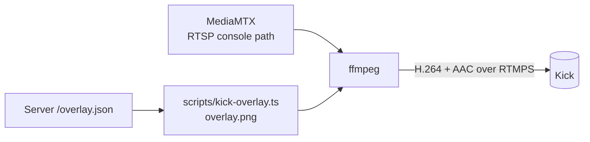

# Streaming to Kick

Direct WebRTC video costs upload bandwidth per viewer, so it is reserved for the controller and a few spectators. Everyone else can watch a restream on Kick. `deploy/macos/run-kick.sh` (the `kick` LaunchAgent) produces it.

## Pipeline

ffmpeg reads the console video from MediaMTX's loopback RTSP server, re-encodes it with the macOS hardware encoder (`h264_videotoolbox`, 6000 kbps constant bitrate, keyframes every 2 seconds as Kick requires) and AAC audio, and pushes it to `KICK_STREAM_URL/KICK_STREAM_KEY`.

Frames from a Wi-Fi console arrive in bursts. The restream holds the video 0.25 s and lays frames out evenly at 30 fps, steering slowly toward the arrival clock so it never drifts from the audio.

The script restarts ffmpeg when the console's stream restarts (its publish time changes) or when the output stops advancing for 15 seconds.

## Overlay

`scripts/kick-overlay.ts` polls `/overlay.json` (local requests only; names, no ids) twice a second and redraws a PNG four times a second:

- **The corner card**: the title (`OVERLAY_TITLE`), a LIVE badge, who is playing with the time left, who is next and how many wait, a call to action with `PUBLIC_URL`, and short announcements ("Ana joined the line", "Bo's turn!").

Names are cut to letters, digits and `. _ -` before they are drawn, so nobody can put symbols or emoji walls on the broadcast. Files are written to a temporary name and renamed, so ffmpeg never reads a half-written PNG.

Try it locally with the server running: `bun run overlay /tmp/overlay.png --once` (add `--standby <epoch ms>` or `--paused` for a slate).

## Slates

When there is no live video, the restream shows a full-frame slate with silent audio instead of nothing:

| Slate   | When                                                                                                                                                | What it shows                                                                                                                                  |
| ------- | --------------------------------------------------------------------------------------------------------------------------------------------------- | ---------------------------------------------------------------------------------------------------------------------------------------------- |
| Standby | The console itself ended Remote Play (someone picked it up). `run-chiaki.sh` detects it in chiaki-ng's log and records a deadline 10 minutes ahead. | "BE RIGHT BACK" and a countdown. When it reaches zero, the Kick stream ends. Nothing reconnects to the console until `deploy/macos/resume.sh`. |
| Outage  | No video for 20 seconds for any other reason (network, crash).                                                                                      | The same slate with a 10-minute countdown that starts over until the video is back.                                                            |
| Paused  | `PAUSED=on`.                                                                                                                                        | "PAUSED FOR NOW", no countdown.                                                                                                                |

The live stream takes over again as soon as the video is back.

## Settings

| Variable                             | Default        | Description                                                                                                           |
| ------------------------------------ | -------------- | --------------------------------------------------------------------------------------------------------------------- |
| `KICK_STREAM_URL`, `KICK_STREAM_KEY` |                | RTMPS ingest. Keep them in `~/Library/Application Support/playgta/kick.env` (mode 600). Without them the agent idles. |
| `OVERLAY_TITLE`                      | `Viewers play` | Title on the overlay and slates.                                                                                      |
| `PUBLIC_URL`                         |                | Shown as the call to action.                                                                                          |

The stream key is redacted from ffmpeg's log output, but ffmpeg only takes it as part of its output URL, so it is on ffmpeg's command line while the restream runs. Any local account can read command lines with `ps`. Run the restream on a machine where no untrusted account can log in, and rotate the key if one could.

Make sure broadcasting the game and letting viewers control it is allowed by the game's and the platform's terms before you go live.
